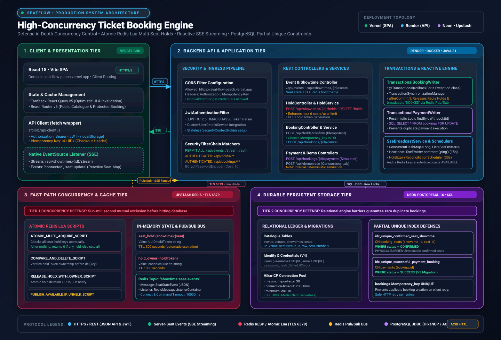

# SeatFlow --- High-Concurrency Ticket Booking Platform

SeatFlow is a full-stack ticket booking application designed to explore
reliable seat reservations under concurrent traffic. It combines a React
frontend with a Spring Boot API, PostgreSQL persistence, and
Redis-backed temporary seat holds and coordination.

## Live Demo

- **Frontend:** [SeatFlow Live Application](https://seat-flow-peach.vercel.app/)
- **Backend API:** [Spring Boot API](https://seatflow-backend-rqoy.onrender.com)
- **Health Check:** [Backend Health Status](https://seatflow-backend-rqoy.onrender.com/actuator/health)
- **Events API:** [Browse Events](https://seatflow-backend-rqoy.onrender.com/api/events)

> **Note:** The backend is hosted on Render and may take a little time to respond after a period of inactivity. Payment processing is simulated and does not use a real payment gateway.

> **Project status:** Academic / portfolio project. Payment processing
> is simulated; do not use this project for real transactions without
> further security, reliability, and payment-provider work.

## Features

-   Browse events, event details, and showtimes.
-   View seat availability and select seats for a showtime.
-   Temporarily hold seats during checkout.
-   Confirm bookings and view booking history and details.
-   User registration, login, and JWT-based authentication.
-   Redis-backed seat holds and coordination for competing booking
    requests.
-   Idempotency support for booking confirmation.
-   Server-Sent Events (SSE) for seat-state updates.
-   Concurrency Lab for exercising competing booking attempts.
-   PostgreSQL schema migrations and seed data managed with Flyway.
-   Docker Compose configuration for local supporting services.

## Tech Stack

  -----------------------------------------------------------------------
  Layer                               Technologies
  ----------------------------------- -----------------------------------
  Frontend                            React, Vite, React Router, TanStack
                                      Query, Tailwind CSS

  Backend                             Java 21, Spring Boot 3.3.4, Spring
                                      Security, Spring Data JPA

  Database                            PostgreSQL 16, Flyway

  Coordination / temporary state      Redis 7

  Build tools                         Maven, npm

  Local infrastructure                Docker Compose
  -----------------------------------------------------------------------

## System Architecture



For the detailed architecture, concurrency guarantees, and booking flow, see [`docs/architecture.md`](docs/architecture.md).

### Architecture Highlights
- **Fast-Path Concurrency (Tier 1 Defense):** Upstash Redis with atomic Lua scripts coordinates multi-seat temporary holds (300-second TTL), enforcing mutual exclusion and user quota limits (maximum 6 seats per user) before touching persistent storage.
- **Durable Relational Ledger (Tier 2 Defense):** Neon PostgreSQL provides durable ledger storage with partial unique constraints (`idx_unique_confirmed_seat_showtime` on `booking_seats` where `status = 'CONFIRMED'`) and row-level locks (`SELECT FOR UPDATE`) as the immutable barrier against race conditions and double-bookings.
- **Reactive Streaming Fanout:** Redis Pub/Sub acts as an inter-node message bus, broadcasting seat status transitions (`HELD`, `AVAILABLE`, `BOOKED`) across Spring Boot nodes to Server-Sent Events (SSE) emitters with 15-second heartbeats for instantaneous client UI synchronization.
- **Idempotent Confirmation:** Client-supplied `Idempotency-Key` headers backed by a `UNIQUE` constraint on `bookings.idempotency_key` prevent duplicate reservations on network retries.
- **Simulated Payment Engine:** Deterministic internal transactional state machine verifying row-level locks and idempotency constraints (not an external payment gateway).

## Repository Structure

``` text
SeatFlow/
├── backend/
│   ├── src/main/java/com/ticketbooking/
│   │   ├── config/
│   │   ├── controller/
│   │   ├── domain/
│   │   ├── dto/
│   │   ├── exception/
│   │   ├── repository/
│   │   ├── scheduler/
│   │   ├── security/
│   │   └── service/
│   ├── src/main/resources/db/migration/
│   ├── src/test/
│   └── pom.xml
├── frontend/
│   ├── src/
│   │   ├── app/
│   │   ├── components/
│   │   ├── lib/
│   │   └── pages/
│   ├── package.json
│   └── vite.config.js
├── docker-compose.yml
├── TicketBooking.md
└── README.md
```

## Prerequisites

-   Java 21
-   Maven
-   Node.js and npm
-   Docker Engine / Docker Desktop with Docker Compose
-   Git

## Getting Started

### 1. Clone the repository

``` bash
git clone https://github.com/RS-8105/SeatFlow.git
cd SeatFlow
git switch development
```

### 2. Configure the environment

Review `docker-compose.yml` and
`backend/src/main/resources/application.yml` to identify required
configuration. Supply local environment values as needed.

-   Keep real credentials in local environment files.
-   Never commit `.env` files, database passwords, JWT secrets, access
    tokens, or other credentials.
-   Use `.env.example` for placeholder values only.

### 3. Start supporting services

If `docker-compose.yml` defines PostgreSQL and Redis services, start
them from the project root:

``` bash
docker compose up -d
```

Check the service definitions and configured ports in
`docker-compose.yml`, and ensure they match the backend configuration.

### 4. Run the backend

From the project root:

``` bash
cd backend
mvn spring-boot:run
```

The API port and configuration are determined by
`backend/src/main/resources/application.yml` and environment overrides.
Review the configuration if the application cannot connect to PostgreSQL
or Redis.

### 5. Run the frontend

In a separate terminal:

``` bash
cd frontend
npm ci
npm run dev
```

Open the local URL printed by Vite.

## Testing

The backend includes a concurrency integration test at:

``` text
backend/src/test/java/com/ticketbooking/ConcurrencyIntegrationTest.java
```

Run backend tests from the `backend/` directory:

``` bash
mvn test
```

Tests may require the services specified in
`backend/src/test/resources/application-test.yml`. Review that file and
ensure the required test dependencies and services are available.

## Concurrency and Booking Flow

1.  The user selects seats for a showtime.
2.  The backend attempts to create a temporary hold for the requested
    seats.
3.  The user proceeds through checkout while the hold is valid.
4.  The backend validates the hold and processes booking confirmation.
5.  The booking is persisted and can be retrieved in booking history and
    booking details.
6.  Seat-state updates can be broadcast to connected clients through
    SSE.

The project demonstrates why concurrency control, hold expiry,
idempotency, database constraints, and server-side validation matter in
ticket booking. Validate the exact guarantees by running the integration
tests and exercising the Concurrency Lab.

## Useful Locations

-   REST controllers:
    `backend/src/main/java/com/ticketbooking/controller/`
-   Security and JWT: backend `security/` and `config/` packages
-   Database migrations and seed data:
    `backend/src/main/resources/db/migration/`
-   Frontend API client: `frontend/src/lib/api-client.js`

Check the local configuration files for actual ports and environment
requirements; do not assume default credentials.

## Security Notes

-   Never commit tokens, passwords, private keys, or production
    credentials.
-   Provide JWT secrets securely; do not hard-code production secrets.
-   Payment behavior is simulated and is not connected to a production
    payment gateway.
-   Before public deployment, review CORS, authorization, secret
    management, rate limiting, logging, migrations, and error handling.

## Current Limitations

-   Payment processing is simulated.
-   Local startup depends on the configuration in Docker Compose and the
    backend application configuration.
-   Concurrency guarantees should be confirmed through automated
    integration tests with the intended PostgreSQL and Redis setup.
-   This is a development / portfolio implementation, not a
    production-ready ticketing service.

## Contributing

1.  Create a feature branch from `development`.
2.  Keep changes focused and add tests for changes affecting holds,
    booking confirmation, idempotency, or concurrency.
3.  Run relevant backend tests and frontend checks.
4.  Open a pull request describing the change and its verification.

## License

No license has been specified yet. Unless a license is added, the
repository's contents are not explicitly licensed for reuse.
