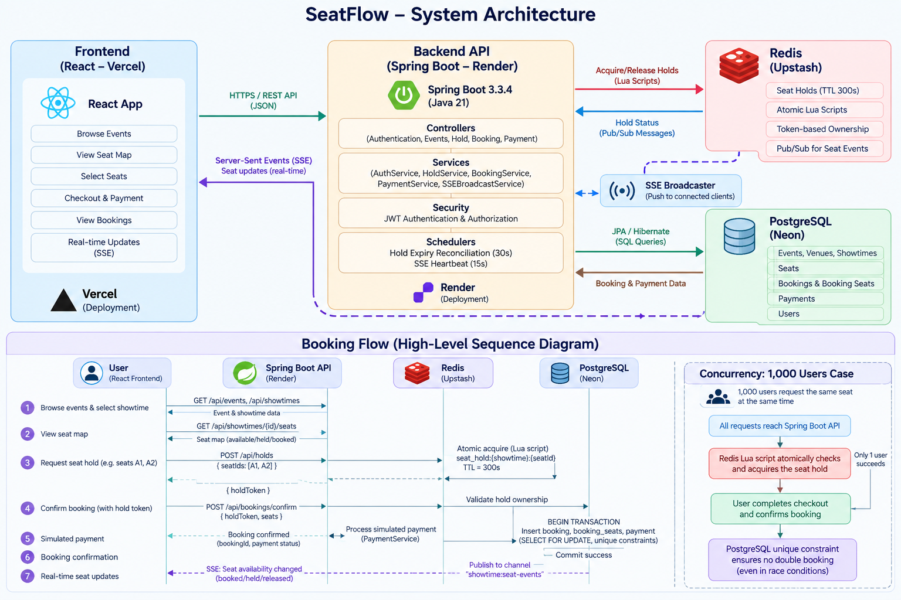

<div align="center">



# SeatFlow — Ticket Booking System

A full-stack ticket booking application built with **React, Spring Boot, PostgreSQL, and Redis**.

[](https://seat-flow-peach.vercel.app/)
[](https://seatflow-backend-rqoy.onrender.com)
[](https://neon.tech/)
[](https://upstash.com/)

**[Live Application](https://seat-flow-peach.vercel.app/) · [Backend Health](https://seatflow-backend-rqoy.onrender.com/actuator/health)**

</div>

---

## Overview

SeatFlow is a full-stack ticket booking system designed to let users browse events, view seat availability, and book seats. Its key engineering challenge is handling concurrent seat requests while preventing duplicate confirmed bookings.

The design separates **temporary seat holds** from **confirmed bookings**: Redis coordinates short-lived holds, while PostgreSQL stores durable booking data and enforces booking constraints.

## Live Deployments

| Component | Deployment |
|---|---|
| Frontend | [https://seat-flow-peach.vercel.app/](https://seat-flow-peach.vercel.app/) |
| Backend API | [https://seatflow-backend-rqoy.onrender.com](https://seatflow-backend-rqoy.onrender.com) |
| Backend health | [Check health status](https://seatflow-backend-rqoy.onrender.com/actuator/health) |
| Events API | [Browse events JSON](https://seatflow-backend-rqoy.onrender.com/api/events) |

> **Note:** The backend root URL (`/`) may require authentication. Use the health endpoint to check service health and `/api/events` to test the public event listing endpoint.

## Tech Stack

### Frontend
- React
- Vite
- TanStack Query / React Query
- Deployed on Vercel

### Backend
- Java 21
- Spring Boot 3.3
- Spring Security and JWT authentication
- Spring Data JPA / Hibernate
- Maven
- Deployed on Render using Docker

### Data and real-time coordination
- PostgreSQL hosted on Neon for durable application data
- Redis hosted on Upstash for temporary seat holds and Pub/Sub
- Server-Sent Events (SSE) for streaming seat-availability updates

## Architecture

```text
Browser
  |
  | HTTPS / REST API
  v
React Frontend (Vercel)
  |
  v
Spring Boot API (Render)
  |                       \
  |                        \ Redis Pub/Sub
  v                         v
PostgreSQL (Neon)       Redis (Upstash)
Durable bookings        Temporary seat holds
                        TTL + atomic hold logic
  |
  v
Booking confirmation and seat-state updates
  |
  v
SSE stream -> connected browsers
```

## Key Features

- Event and showtime discovery
- Seat map and availability display
- JWT-based authentication
- Temporary seat holds with automatic expiry
- Atomic multi-seat hold acquisition using Redis Lua scripting
- Token-aware hold release to prevent stale cleanup from deleting a newer hold
- Booking confirmation backed by PostgreSQL transactions and database constraints
- Idempotency handling for retry-safe booking operations
- Real-time seat updates using Redis Pub/Sub and Server-Sent Events
- Docker-based backend deployment
- Automated backend tests covering concurrency, booking lifecycle, security, and payment workflow

> Payment behavior is simulated; this project should not be described as integrating a real payment gateway unless one is added.

## How Seat Booking Works

1. A user browses events and chooses a showtime.
2. The frontend requests the seat map from the backend.
3. The backend checks durable booking state and attempts to acquire temporary Redis holds.
4. Redis hold acquisition is atomic for the requested group of seats, and the hold expires after its configured TTL.
5. During confirmation, the backend validates hold ownership and calculates the price server-side.
6. PostgreSQL persists the booking transactionally and its constraints protect against duplicate confirmed seats.
7. Seat updates are published and streamed to connected clients.

### Why both Redis and PostgreSQL?

- **Redis** is used for short-lived coordination and expiring seat holds.
- **PostgreSQL** is the durable source of truth for confirmed bookings.
- **Database constraints** provide a final safeguard against duplicate confirmed seat assignments.
- **SSE** notifies clients about changes; it does not itself guarantee booking correctness.

## System Architecture

The following diagram illustrates SeatFlow's frontend, backend, persistent storage, Redis-based seat holds, and real-time seat availability updates.


For the detailed architecture and design decisions, see [`docs/architecture.md`](docs/architecture.md).

### Booking Flow and Concurrency

The booking sequence diagram explains temporary seat holds, atomic Redis operations, booking confirmation, simulated payments, and real-time updates.

See [`docs/booking-flow-sequence.mmd`](docs/booking-flow-sequence.mmd).

## Testing

The backend test suite completed successfully with:

- **71 tests**
- **0 failures**
- **0 errors**
- **0 skipped**

The suite includes concurrency, booking lifecycle, API security, and payment workflow integration tests.

## Run Locally

### Prerequisites

- Java 21
- Maven
- Node.js and npm
- PostgreSQL
- Redis

Configure the required database, Redis, and JWT environment values locally. Do not commit credentials or `.env` files.

### Backend

```bash
cd backend
mvn spring-boot:run
```

### Frontend

```bash
cd frontend
npm install
```

Create a frontend environment file such as `.env.local` and set the API base URL:

```env
VITE_API_BASE_URL=http://localhost:8080/api
```

Then run:

```bash
npm run dev
```

For a production frontend build:

```bash
npm run build
```

The frontend's `VITE_API_BASE_URL` value is embedded into the browser bundle at build time. Never place passwords, JWT signing secrets, or private API keys in `VITE_*` variables.

## Environment Configuration

The deployed backend uses environment-based configuration for database connectivity, Redis, JWT, and CORS. Set values in the hosting provider's environment settings rather than committing secrets.

For the deployed frontend, configure:

```env
VITE_API_BASE_URL=https://seatflow-backend-rqoy.onrender.com/api
```

## Possible Future Improvements

- Integrate a real payment provider with idempotent payment operations, webhook handling, and refund reconciliation
- Add structured logs, metrics, tracing, and alerting
- Add load testing for high-contention showtimes
- Improve seat-state resynchronization after SSE reconnects
- Add booking cancellation and refund workflows
- Define explicit recovery handling for failures between PostgreSQL commits and Redis cleanup

## Project Highlights

SeatFlow demonstrates full-stack development, REST API design, authentication, relational data modeling, temporary distributed coordination, concurrency control, transactional booking workflows, real-time event delivery, automated testing, and cloud deployment.

---

<div align="center">

**SeatFlow** · Full-stack ticket booking system

[Open the live app](https://seat-flow-peach.vercel.app/)

</div>
