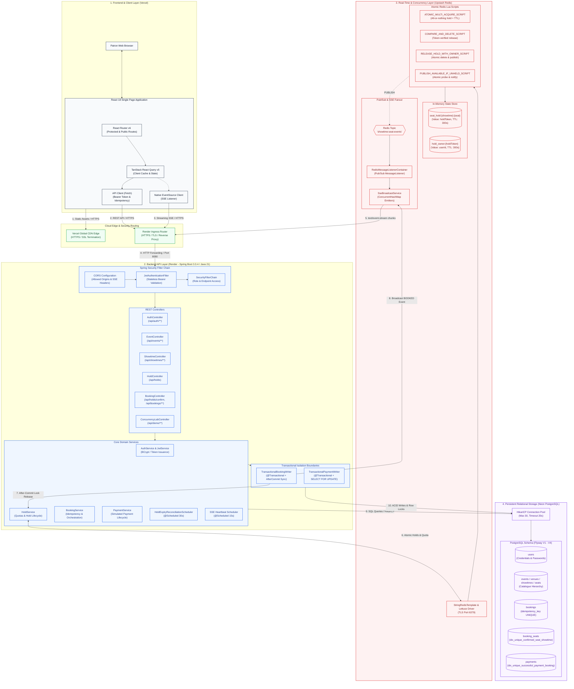
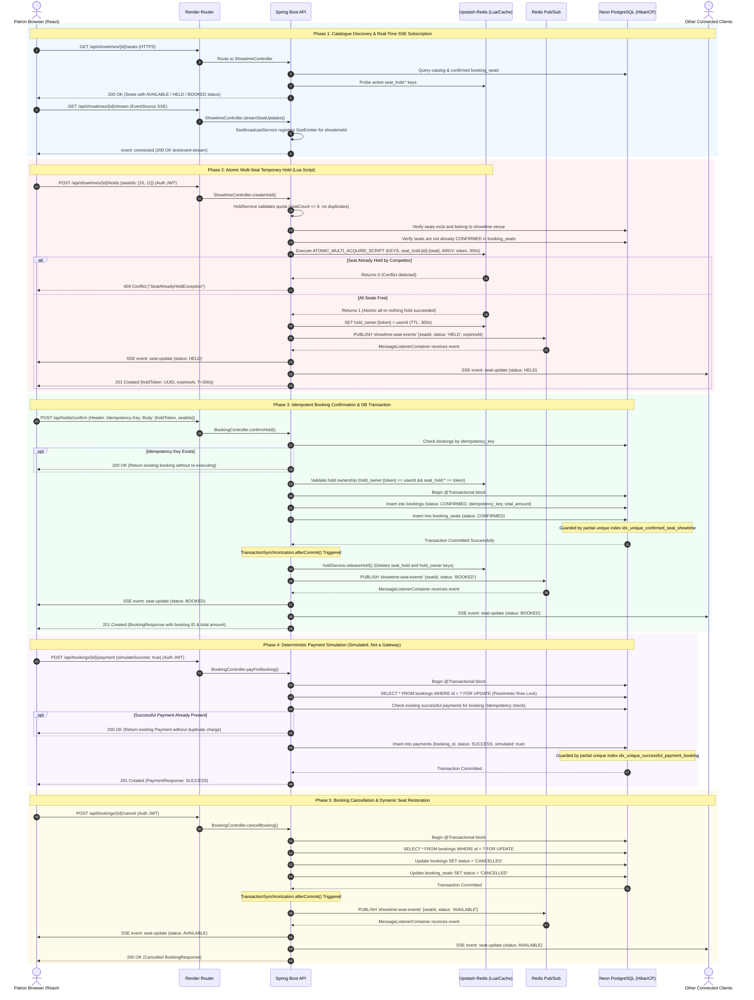

# SeatFlow — System Architecture & Concurrency Design

This document details the complete production architecture, concurrency controls, real-time streaming pipeline, and data guarantees implemented in the **SeatFlow** high-concurrency ticket booking engine.

---

## 1. Executive Architecture Overview

SeatFlow is engineered to solve the classic high-concurrency event ticketing problem: **guaranteeing zero double-bookings during flash-sale traffic spikes while maintaining sub-second latency and real-time state synchronization across thousands of concurrent clients.**

The platform employs a **defense-in-depth architecture**:
* **Optimized In-Memory Locking (Fast Path):** Upstash Redis with atomic Lua scripts coordinates multi-seat temporary holds (300-second TTL), enforcing mutual exclusion and user quota limits before touching persistent storage.
* **Transactional ACID Persistence (Durable Path):** Neon PostgreSQL provides durable ledger storage with database-level partial unique constraints and pessimistic row locking (`SELECT FOR UPDATE`) as the final defense against race conditions.
* **Real-Time Reactive Streaming:** Redis Pub/Sub acts as an inter-node message bus, fanning out seat status transitions to Spring Boot Server-Sent Events (SSE) emitters for instantaneous client UI synchronization.

---

## 2. End-to-End System Architecture Diagram

---

## 3. End-to-End Booking Lifecycle & Concurrency Sequence

The sequence diagram below models the exact chronological lifecycle from discovery to simulated payment and cancellation, detailing:
1. Discovery and SSE connection establishment.
2. Atomic multi-seat hold acquisition via Redis Lua script.
3. Idempotent booking persistence with PostgreSQL transactional synchronization.
4. Pessimistic row-locking payment simulation.
5. Cancellation and automatic seat restoration.

---

## 4. Deep-Dive Component Technical Specifications

### A. Concurrency & Double-Booking Protection (Two-Tier Defense)

SeatFlow utilizes a dual-tier protection model to eliminate race conditions:

| Tier | Component | Mechanism | Guarantees |
| :--- | :--- | :--- | :--- |
| **Tier 1 (In-Memory)** | Upstash Redis | Atomic Lua Script (`ATOMIC_MULTI_ACQUIRE_SCRIPT`) | • Sub-millisecond mutual exclusion • Atomically checks all requested seats; if any seat is held, rejects entire request with zero side effects • Auto-expires stale holds after 300s via native Redis TTL • Enforces max 6 seats per user quota |
| **Tier 2 (Durable DB)** | Neon PostgreSQL | Partial Unique Index (`idx_unique_confirmed_seat_showtime`) | • Hard relational boundary: `CREATE UNIQUE INDEX ... WHERE status = 'CONFIRMED'` • Guarantees that even in the event of an unexpected Redis cache eviction or split-brain, PostgreSQL physically rejects concurrent duplicate seat confirmations |

### B. Idempotency Architecture
* **Hold Tokens:** Each hold is assigned an unguessable UUID token (`holdToken`). All subsequent release and confirmation requests must prove ownership of both the hold token and the authenticated user identity (`hold_owner:{holdToken}`).
* **Client Idempotency Key:** `POST /api/holds/confirm` mandates an `Idempotency-Key` HTTP header. The database enforces a `UNIQUE` constraint on `bookings.idempotency_key`. Redundant requests return the existing booking record rather than re-executing transactions.
* **Payment Idempotency:** Payment execution checks existing successful records under a pessimistic row lock (`SELECT FOR UPDATE`), backed by partial unique index `idx_unique_successful_payment_booking WHERE status = 'SUCCESS'`.

### C. Real-Time Streaming & Pub/Sub Architecture
* **Cluster-Safe Notification:** When a seat status changes (`HELD`, `AVAILABLE`, `BOOKED`), Spring Boot publishes an event to Redis channel `showtime:seat-events`.
* **Distributed Fanout:** All Spring Boot application nodes subscribe via `RedisMessageListenerContainer`. Upon receipt, each node pushes the update across active `SseEmitter` instances for that specific showtime.
* **Connection Liveness:** `SseBroadcastService.sendHeartbeats()` issues periodic `:ping` comments every 15 seconds to prevent browser timeouts and proxies (e.g., Cloudflare/Render) from terminating idle HTTP streams.
* **Reconciliation Engine:** `HoldExpiryReconciliationScheduler` runs on a 30-second fixed rate, auditing active showtime seats against Redis keys and publishing `"AVAILABLE"` events if holds have expired naturally without explicit release.

### D. Security & Identity
* **Authentication:** Stateless JSON Web Tokens (JJWT 0.12.6) signed using HMAC-SHA256 (`ticketbooking.jwt.secret`).
* **Password Security:** Salted BCrypt password encoding via `BCryptPasswordEncoder`.
* **CORS Policy:** Strict origin whitelisting (`https://seat-flow-peach.vercel.app` + development origins), explicitly prohibiting wildcard origins when `allowCredentials=true` is enabled.

---

## 5. Implementation Verification & Boundaries

* **Simulated Payment Engine:** The payment workflow (`PaymentService`, `TransactionalPaymentWriter`, `/api/bookings/{id}/payment`) is a **deterministic state-machine simulation** built for testing concurrency, idempotent retries, and failure recovery. It does **not** connect to external payment gateways (e.g., Stripe, PayPal, Razorpay).
* **Cross-Cloud Deployment:**
  - Frontend SPA hosted on **Vercel** with CDN edge caching and client-side routing.
  - Backend hosted on **Render** as a containerized Docker image running Eclipse Temurin Java 21 on a non-root user.
  - Database hosted on **Neon Serverless PostgreSQL** via SSL JDBC.
  - Cache hosted on **Upstash Serverless Redis** via TLS port 6379 with custom connection and command timeout resilience.
